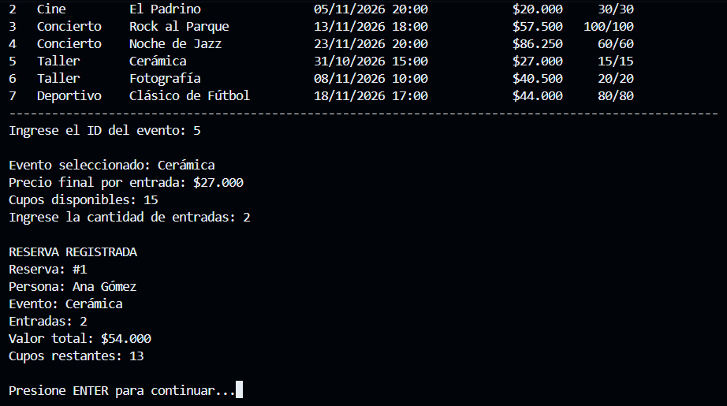
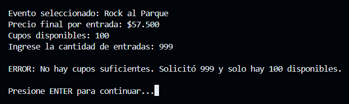
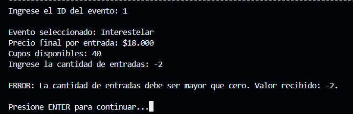
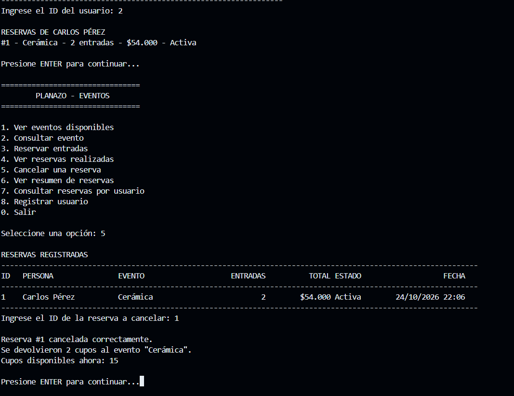
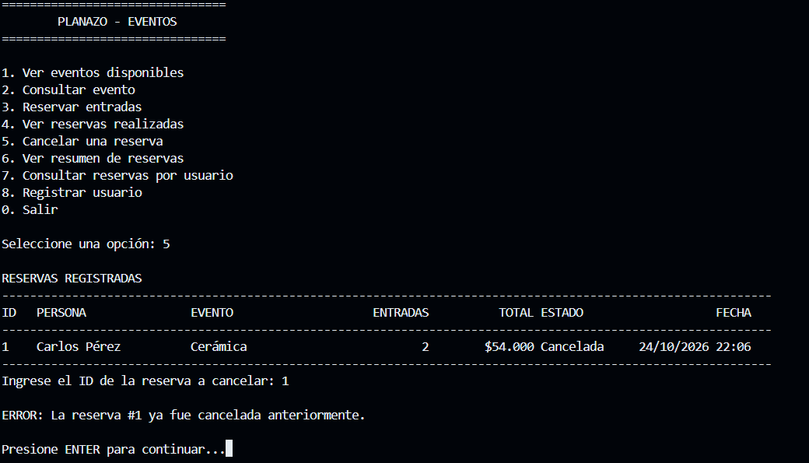
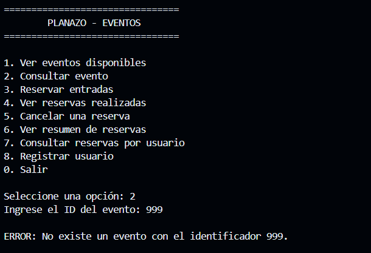
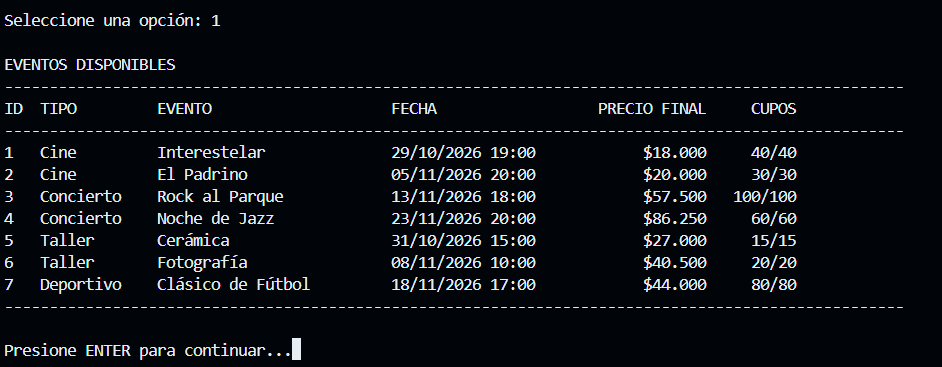
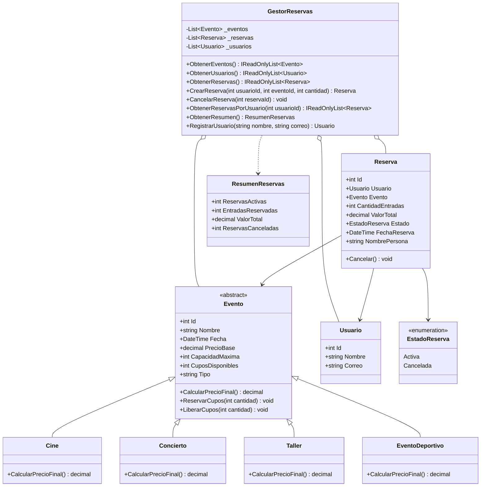

# PLANAZO - Sistema de eventos y reservas

Aplicación de consola desarrollada en C# con .NET para la gestión de eventos y reservas de la empresa PLANAZO. El proyecto aplica los conceptos de Programación Orientada a Objetos: encapsulamiento, abstracción, herencia, polimorfismo, composición, colecciones y manejo de excepciones.

## Funcionalidades

- Listado de los eventos registrados con su precio final y cupos disponibles.
- Consulta de un evento por su identificador.
- Registro de reservas asociadas a un usuario y a un evento.
- Control automático de cupos al reservar y al cancelar.
- Validación de cantidades negativas, cero o superiores a los cupos disponibles.
- Cancelación de reservas con devolución de cupos.
- Bloqueo de la doble cancelación de una misma reserva.
- Consulta de todas las reservas realizadas.
- Resumen de reservas activas, entradas reservadas y valor total.
- Consulta de reservas por usuario.
- Registro de nuevos usuarios.
- Cálculo polimórfico del precio final según el tipo de evento.

## Requisitos

- .NET SDK 8.0 o superior.
- Terminal o consola de comandos.

El proyecto se compiló y ejecutó con .NET SDK 10.0.402. El archivo de proyecto apunta a .NET 8 para mantener compatibilidad y permite ejecutarse con versiones posteriores del runtime.

## Cómo ejecutar

Desde la carpeta del proyecto:

```bash
dotnet run
```

Si se está en la carpeta superior del workspace:

```bash
dotnet run --project PlanazoApp/PlanazoApp.csproj
```

## Menú

```text
================================
        PLANAZO - EVENTOS
================================

1. Ver eventos disponibles
2. Consultar evento
3. Reservar entradas
4. Ver reservas realizadas
5. Cancelar una reserva
6. Ver resumen de reservas
7. Consultar reservas por usuario
8. Registrar usuario
0. Salir
```

Las opciones 7 y 8 corresponden al reto adicional de gestión de usuarios.

## Estructura del proyecto

```text
PLANAZO-POO-CSharp/
├── PlanazoApp.csproj
├── Program.cs
├── README.md
├── .gitignore
├── Modelos/
│   ├── Evento.cs
│   ├── Cine.cs
│   ├── Concierto.cs
│   ├── Taller.cs
│   ├── EventoDeportivo.cs
│   ├── Usuario.cs
│   ├── Reserva.cs
│   └── EstadoReserva.cs
├── Servicios/
│   ├── GestorReservas.cs
│   └── ResumenReservas.cs
├── Excepciones/
│   ├── PlanazoException.cs
│   └── ExcepcionesDeNegocio.cs
├── UI/
│   └── MenuConsola.cs
└── Capturas/
    ├── README.md
    └── caso-01-reserva-valida.png
```

En el workspace local, el proyecto está dentro de la carpeta `PlanazoApp`. Al publicarlo, el contenido de esa carpeta corresponde a la raíz del repositorio.

## Clases y relaciones

### `Evento`

Es la clase abstracta que representa cualquier evento de PLANAZO. Contiene el identificador, el nombre, la fecha, el precio base, la capacidad máxima y los cupos disponibles. Valida sus datos en el constructor y controla la modificación de los cupos mediante los métodos `ReservarCupos` y `LiberarCupos`.

### `Cine`, `Concierto`, `Taller` y `EventoDeportivo`

Son las clases derivadas de `Evento`. Cada una implementa su propia regla de precio:

- `Cine`: conserva el precio base.
- `Concierto`: aumenta el precio base en un 15 %.
- `Taller`: aplica un descuento del 10 %.
- `EventoDeportivo`: aumenta el precio base en un 10 %.

### `Usuario`

Representa a la persona que realiza una reserva. Tiene identificador, nombre y correo electrónico. El correo se valida y no se permiten dos usuarios con el mismo correo.

### `Reserva`

Asocia un usuario con un evento. Guarda el identificador, la cantidad de entradas, el valor total calculado, la fecha de creación y el estado. Su método `Cancelar` devuelve los cupos al evento y lanza una excepción si la reserva ya estaba cancelada.

### `GestorReservas`

Es el servicio central del sistema. Administra las listas de eventos, usuarios y reservas, genera los identificadores, crea y cancela reservas, consulta las reservas de un usuario y calcula el resumen general.

### `ResumenReservas`

Objeto de transferencia que contiene los datos del resumen: reservas activas, entradas reservadas, valor total de las reservas activas y reservas canceladas.

### `MenuConsola`

Contiene la interacción con el usuario: muestra el menú, lee y valida las entradas, ejecuta las opciones y presenta los mensajes de error. No contiene las reglas de negocio.

### `Program`

Es únicamente el punto de entrada. Crea el gestor, crea el menú y lo ejecuta.

## Conceptos de Programación Orientada a Objetos

### Encapsulamiento

Los datos de los eventos se protegen con propiedades de solo lectura y con un `private set` para los cupos. Los cupos no se modifican directamente desde el menú; solo cambian mediante los métodos del evento, que validan la operación.

```csharp
public int CuposDisponibles { get; private set; }

public void ReservarCupos(int cantidad)
{
    if (cantidad <= 0)
        throw new CantidadInvalidaException(cantidad);

    if (cantidad > CuposDisponibles)
        throw new CupoInsuficienteException(cantidad, CuposDisponibles);

    CuposDisponibles -= cantidad;
}
```

La reserva también protege su estado: el estado solo puede cambiar mediante `Cancelar`, que impide una segunda cancelación.

```csharp
public EstadoReserva Estado { get; private set; }

public void Cancelar()
{
    if (Estado == EstadoReserva.Cancelada)
        throw new ReservaYaCanceladaException(Id);

    Evento.LiberarCupos(CantidadEntradas);
    Estado = EstadoReserva.Cancelada;
}
```

### Abstracción

`Evento` define las características comunes y obliga a todas las clases derivadas a implementar `CalcularPrecioFinal`. El resto del sistema trabaja con la abstracción y no necesita conocer la regla interna de cada tipo.

```csharp
public abstract class Evento
{
    public abstract decimal CalcularPrecioFinal();
}
```

### Herencia

`Cine`, `Concierto`, `Taller` y `EventoDeportivo` heredan de `Evento`. Reutilizan el identificador, el nombre, la fecha, el precio base, la capacidad, los cupos y las validaciones.

```csharp
public sealed class Concierto : Evento
{
    public override decimal CalcularPrecioFinal()
    {
        return Redondear(PrecioBase * 1.15m);
    }
}
```

### Polimorfismo

El gestor almacena todos los eventos en una lista de tipo `List<Evento>`. Al recorrer la lista y llamar a `CalcularPrecioFinal`, cada objeto ejecuta su propia implementación.

```csharp
private readonly List<Evento> _eventos;

foreach (var evento in _eventos)
{
    Console.WriteLine(evento.CalcularPrecioFinal());
}
```

El mismo método produce resultados diferentes según el tipo de evento. Esto permite agregar `EventoDeportivo` sin modificar los cálculos de `Cine`, `Concierto` o `Taller`.

### Composición y asociaciones

`GestorReservas` contiene las colecciones de eventos, usuarios y reservas. Una `Reserva` está asociada a un `Usuario` y a un `Evento`.

```csharp
public sealed class Reserva
{
    public Usuario Usuario { get; }
    public Evento Evento { get; }
}
```

### Colecciones

Se utilizan `List<Evento>`, `List<Usuario>` y `List<Reserva>` para almacenar la información. El gestor expone las listas como `IReadOnlyList` para evitar modificaciones externas.

### Excepciones

Las reglas de negocio lanzan excepciones propias que heredan de `PlanazoException`:

- `EventoNoEncontradoException`
- `UsuarioNoEncontradoException`
- `ReservaNoEncontradaException`
- `CupoInsuficienteException`
- `CantidadInvalidaException`
- `ReservaYaCanceladaException`
- `CorreoDuplicadoException`

El menú captura estas excepciones y muestra un mensaje. Un error de negocio no cierra la aplicación.

### Constructores

Los constructores inicializan los objetos y validan sus datos. Por ejemplo, el constructor de `Reserva` comprueba la cantidad, verifica los cupos y calcula el valor total con `decimal`.

```csharp
ValorTotal = decimal.Round(
    evento.CalcularPrecioFinal() * cantidadEntradas,
    2,
    MidpointRounding.AwayFromZero);
```

### Uso de `decimal`

Todos los precios y valores monetarios se manejan con `decimal`: `PrecioBase`, `ValorTotal` de las reservas y `ValorTotal` del resumen. La presentación se formatea con la cultura `es-CO`.

## Precios de los eventos iniciales

| ID | Tipo | Evento | Precio base | Precio final | Cupos |
|---:|---|---|---:|---:|---:|
| 1 | Cine | Interestelar | $18.000 | $18.000 | 40 |
| 2 | Cine | El Padrino | $20.000 | $20.000 | 30 |
| 3 | Concierto | Rock al Parque | $50.000 | $57.500 | 100 |
| 4 | Concierto | Noche de Jazz | $75.000 | $86.250 | 60 |
| 5 | Taller | Cerámica | $30.000 | $27.000 | 15 |
| 6 | Taller | Fotografía | $45.000 | $40.500 | 20 |
| 7 | Deportivo | Clásico de Fútbol | $40.000 | $44.000 | 80 |

Usuarios iniciales:

| ID | Nombre | Correo |
|---:|---|---|
| 1 | Ana Gómez | ana@planazo.com |
| 2 | Carlos Pérez | carlos@planazo.com |
| 3 | Laura Rodríguez | laura@planazo.com |

## Casos de prueba

| # | Caso | Entradas principales | Resultado esperado | Captura |
|---:|---|---|---|---|
| 1 | Reserva válida | Opción 3, usuario 1, evento 5, cantidad 2 | Reserva #1, total $54.000 y 13 cupos restantes | [Ver](Capturas/caso-01-reserva-valida.png) |
| 2 | Cupos insuficientes | Opción 3, usuario 1, evento 3, cantidad 999 | Mensaje de error; no se crea la reserva | [Ver](Capturas/caso-02-cupos-insuficientes.png) |
| 3 | Cantidad inválida | Opción 3, usuario 1, evento 1, cantidad -2 | Mensaje de error; no se crea la reserva | [Ver](Capturas/caso-03-cantidad-invalida.png) |
| 4 | Cancelación y devolución de cupos | Reservar 2 en el evento 5, consultar, cancelar y volver a consultar | Los cupos vuelven de 13 a 15 | [Ver](Capturas/caso-04-cancelacion-devuelve-cupos.png) |
| 5 | Doble cancelación | Intentar cancelar dos veces la reserva #1 | Mensaje “ya fue cancelada anteriormente” | [Ver](Capturas/caso-05-doble-cancelacion.png) |
| 6 | Evento inexistente | Opción 2, evento 999 | Mensaje “No existe un evento” | [Ver](Capturas/caso-06-evento-inexistente.png) |
| 7 | Precios por tipo | Opción 1 | Se muestran los precios finales correctos de los cuatro tipos | [Ver](Capturas/caso-07-precios-por-tipo.png) |


### Evidencia de los casos de prueba

**Caso 1: reserva válida**



**Caso 2: cupos insuficientes**



**Caso 3: cantidad inválida**



**Caso 4: cancelación y devolución de cupos**



**Caso 5: doble cancelación**



**Caso 6: evento inexistente**



**Caso 7: precios por tipo de evento**



## Retos adicionales

### Reto 1: nuevo tipo de evento

Se agregó `EventoDeportivo`, que hereda de `Evento` y aplica un recargo del 10 % sobre el precio base. No fue necesario modificar los métodos `CalcularPrecioFinal` de `Cine`, `Concierto` ni `Taller`.

Ejemplo: un evento deportivo con precio base de $40.000 calcula un precio final de $44.000.

### Reto 2: gestión de usuarios

Se agregó la clase `Usuario` y la reserva ahora se asocia a un usuario. El menú permite registrar usuarios (opción 8) y consultar todas las reservas de un usuario (opción 7). La relación se implementa con la propiedad `Usuario` de `Reserva` y el método `ObtenerReservasPorUsuario` del gestor.

### Reto 3: diagrama UML



## Pregunta de sustentación

**¿Por qué se utilizó una clase abstracta `Evento` en lugar de crear clases completamente independientes para Cine, Concierto y Taller? ¿Qué ventajas tiene esta decisión cuando necesitamos agregar un nuevo tipo de evento?**

Se utilizó una clase abstracta `Evento` porque todos los tipos de evento comparten los mismos datos y comportamientos: identificador, nombre, fecha, precio base, capacidad, cupos, validaciones y control de disponibilidad. Si `Cine`, `Concierto` y `Taller` fueran clases independientes, habría que repetir esos atributos y métodos en cada una, con el riesgo de que las validaciones quedaran inconsistentes.

La clase abstracta permite reutilizar toda esa lógica mediante herencia y define un contrato común: todas las clases derivadas deben implementar `CalcularPrecioFinal()`. El gestor puede almacenar los eventos en una sola colección `List<Evento>` y calcular los precios sin preguntar de qué tipo son. Eso es polimorfismo: una misma llamada, `evento.CalcularPrecioFinal()`, produce $18.000 para un cine, $57.500 para un concierto de $50.000, $27.000 para un taller de $30.000 y $44.000 para un evento deportivo de $40.000.

La ventaja principal se vio al agregar `EventoDeportivo`: solo se creó una nueva clase derivada con su propia regla de precio y se agregó al listado inicial. No fue necesario modificar los métodos de cálculo de `Cine`, `Concierto` o `Taller`, ni el código del menú que recorre los eventos. Si en el futuro se agrega un festival o una obra de teatro, el cambio se limita a una nueva clase derivada y a su registro inicial, manteniendo el resto del sistema intacto.

## Autor

Sangdo Hernandez 
Parcial de Programación Orientada a Objetos
